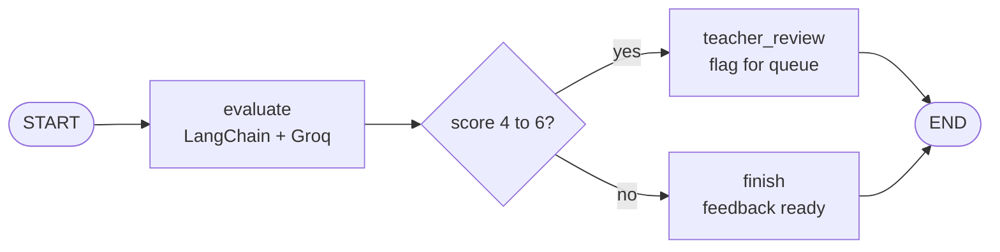
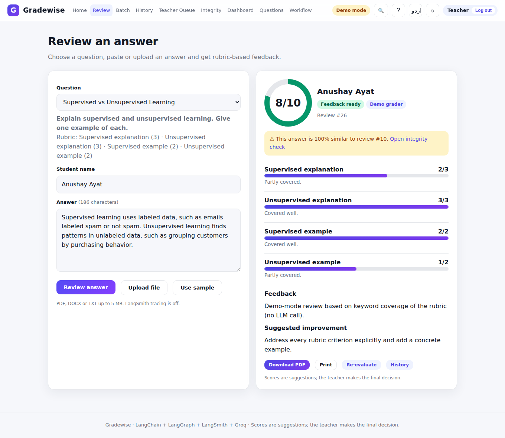
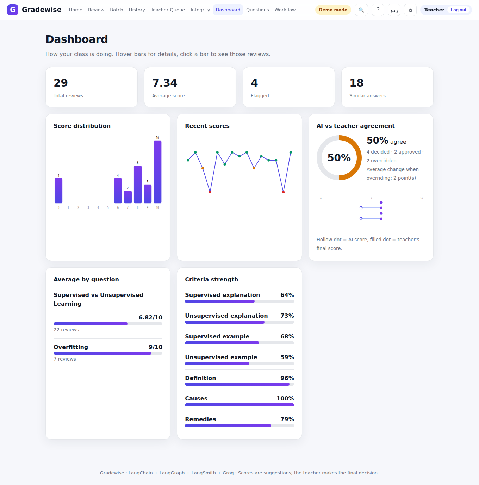
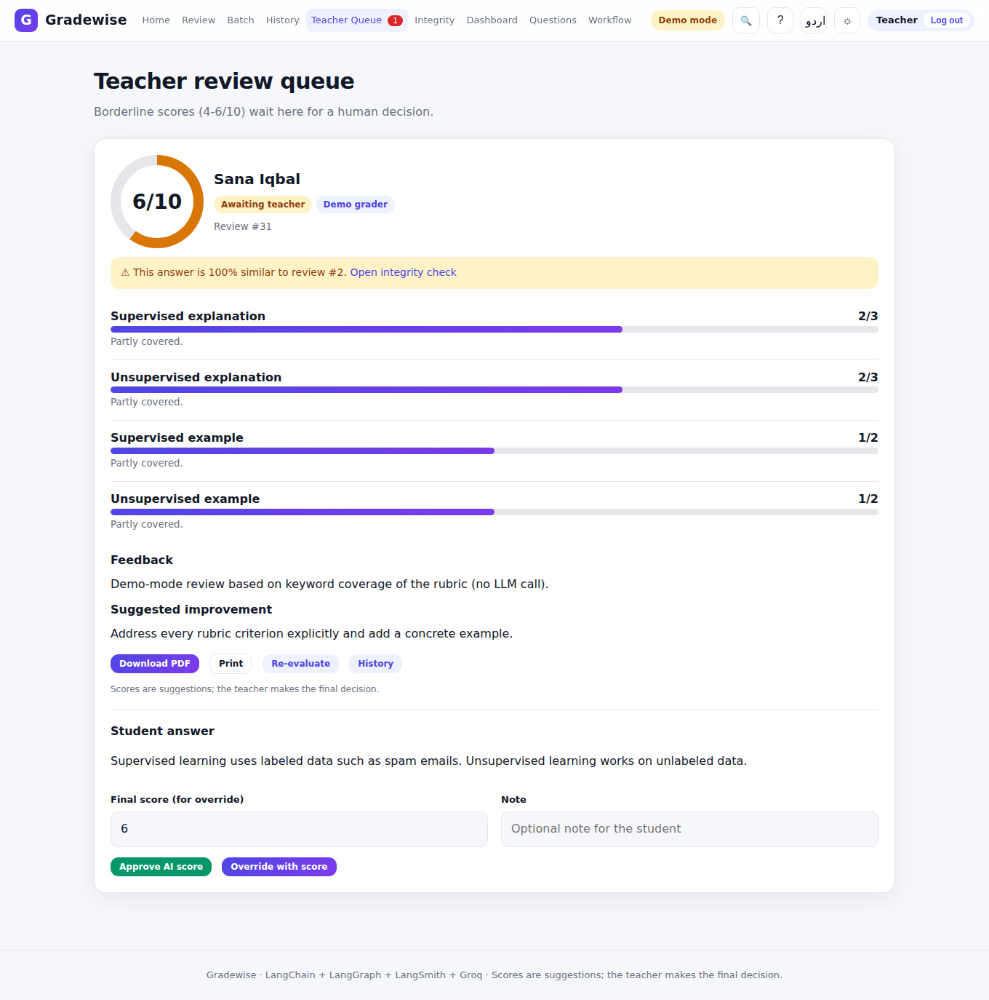
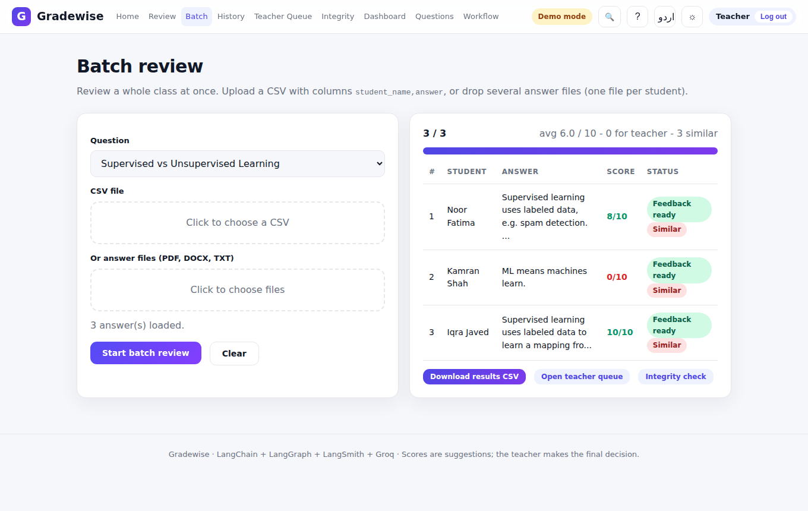
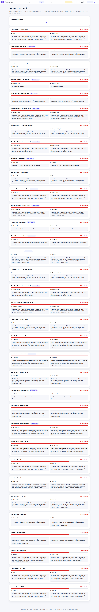
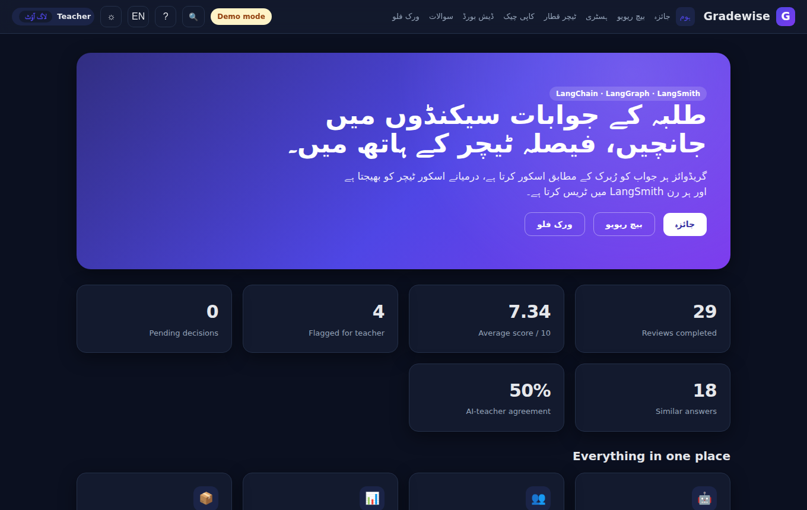
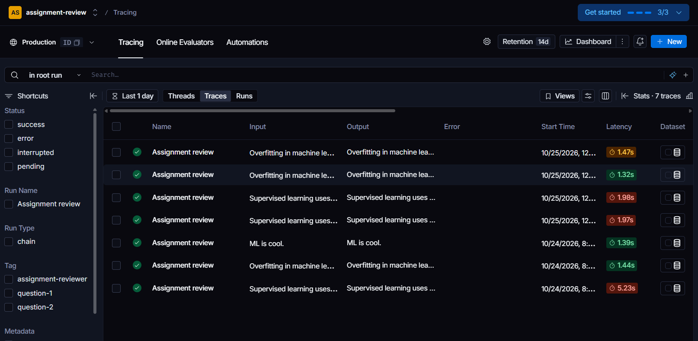
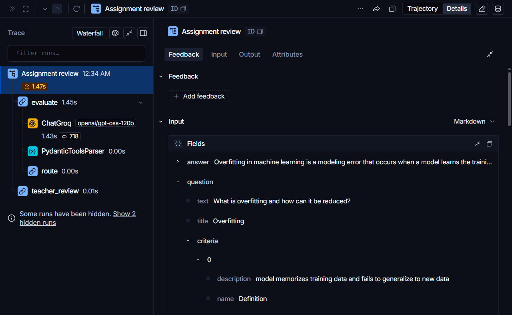

<div align="center">


# Gradewise

### AI Assignment Reviewer with a Teacher-in-the-Loop

Rubric-based AI scoring, a teacher approval queue, and full LangSmith tracing, built on LangChain, LangGraph and Groq.

[](https://www.python.org/)
[](https://fastapi.tiangolo.com/)
[](https://www.langchain.com/)
[](https://www.langchain.com/langgraph)
[](https://smith.langchain.com/)
[](https://groq.com/)
[](https://www.sqlite.org/)
[](https://developer.mozilla.org/docs/Web/JavaScript)


[Features](#-features) · [Screenshots](#-screenshots) · [Quick start](#-quick-start) · [LangSmith](#-langsmith-tracing) · [API](#-api) · [Deploy](#-deployment)

</div>

---

## Overview

**Gradewise** turns a teacher's terminal exercise into a complete web application. A student answer is scored against a rubric by an LLM, borderline results (4 to 6 out of 10) are sent to a teacher for a human decision, and every run is traced in LangSmith, including the teacher's final decision.

> The AI score is a suggestion. The teacher always has the final say.

## Workflow



The graph and the 4 to 6 routing rule come from the original assignment. Scores from custom rubrics are normalised to a 0 to 10 scale so the rule works for every question.

## Features

| | |
|---|---|
| **Rubric scoring** | Per-criterion marks and comments, clamped to each criterion's maximum |
| **Teacher queue** | Approve the AI score or override it with a note |
| **Batch review** | Upload a CSV or many files and review a whole class with live progress |
| **File upload** | Read answers from PDF, DOCX or TXT |
| **Integrity check** | Detects near-identical answers (word 3-gram Jaccard similarity) |
| **Dashboard** | Distribution, trend, per-question averages, criteria strength, AI vs teacher agreement |
| **Re-evaluate** | Re-run a review and compare with the previous score |
| **Accounts and roles** | Teacher and student logins; students see only their own results |
| **Exports** | Result PDF per review and CSV of all reviews |
| **LangSmith tracing** | Named runs, tags, metadata and teacher feedback on each run |
| **Great UX** | Command palette (`Ctrl+K`), shortcuts, guided tour, dark mode, English and Urdu (RTL), print view |
| **Demo mode** | Offline keyword grader when no Groq key is set |

## Screenshots

<table>
  <tr>
    <td><br /><sub><b>Review result</b></sub></td>
    <td><br /><sub><b>Dashboard and agreement</b></sub></td>
  </tr>
  <tr>
    <td><br /><sub><b>Teacher queue</b></sub></td>
    <td><br /><sub><b>Batch review</b></sub></td>
  </tr>
  <tr>
    <td><br /><sub><b>Integrity check</b></sub></td>
    <td><br /><sub><b>Urdu and dark mode</b></sub></td>
  </tr>
</table>

### LangSmith traces




## Tech stack

| Layer | Technology |
|---|---|
| API | FastAPI, Uvicorn, Pydantic v2 |
| AI | LangChain prompt + Groq model (structured output) |
| Workflow | LangGraph state graph with a conditional edge |
| Observability | LangSmith |
| Storage | SQLite |
| Files and reports | pypdf, python-docx, ReportLab |
| Frontend | Vanilla JavaScript SPA, CSS, SVG charts |
| Tests | pytest, httpx |

## Project structure

```
assignment-reviewer/
├── run.py                    start the app
├── requirements.txt
├── .env.example
├── backend/
│   ├── app/
│   │   ├── main.py  config.py  db.py  schemas.py
│   │   ├── api/routes.py     REST endpoints (role-aware)
│   │   ├── graph/            state, nodes, builder (LangGraph)
│   │   └── services/         llm, tracing, pdf, auth, similarity, extract
│   └── tests/test_api.py
├── frontend/                 index.html, css/, js/, favicon.svg
├── docs/                     report, presentation, screenshots
└── data/                     SQLite database (created at runtime)
```

## Quick start

```bash
git clone https://github.com/scientistayat-engineer/assignment-reviewer.git
cd assignment-reviewer

python -m venv .venv
.venv\Scripts\activate            # Windows  (Mac/Linux: source .venv/bin/activate)
pip install -r requirements.txt

copy .env.example .env            # Mac/Linux: cp .env.example .env
python run.py
```

Open **http://127.0.0.1:8000** and log in as the teacher, or create a student account.

### Environment variables

| Variable | Purpose |
|---|---|
| `GROQ_API_KEY` | Groq key. Leave empty to run in demo mode |
| `GROQ_MODEL` | Model name (default `openai/gpt-oss-120b`) |
| `LANGSMITH_TRACING` | `true` to enable tracing |
| `LANGSMITH_API_KEY` | LangSmith key |
| `LANGSMITH_PROJECT` | Project name (default `assignment-review`) |
| `TEACHER_USERNAME` / `TEACHER_PASSWORD` | Teacher account. **Change the password** |
| `SECRET_KEY` | Long random string that signs login cookies |
| `REVIEW_MIN` / `REVIEW_MAX` | Teacher-review score band (default 4 to 6) |

## LangSmith tracing

Every review is one run named **Assignment review**, with tags, the student name and question title as metadata, and child spans for each graph node and the Groq call.
When the teacher approves or overrides a score, the final score is posted to that run as `teacher_final_score` feedback.

Open [smith.langchain.com](https://smith.langchain.com/) → **Projects** → `assignment-review` to inspect runs.

> With tracing on, prompts and answers are sent to LangSmith. Use fictional or consented data.

## Roles

| Capability | Teacher | Student |
|---|:---:|:---:|
| Submit an answer, view own results, download PDF | ✅ | ✅ |
| See all reviews, history and CSV export | ✅ | ❌ |
| Create or delete questions | ✅ | ❌ |
| Teacher queue, batch review, re-evaluate | ✅ | ❌ |
| Dashboard and integrity check | ✅ | ❌ |

## API

| Endpoint | Who | Purpose |
|---|---|---|
| `POST /api/auth/login`, `/register`, `/logout` · `GET /api/auth/me` | all | accounts |
| `GET /api/questions` | all | questions and rubrics |
| `POST /api/reviews` | all | run the graph and store a review |
| `GET /api/reviews`, `GET /api/reviews/{id}`, `/pdf` | all (students: own) | results |
| `POST /api/extract` | all | text from PDF, DOCX, TXT |
| `POST /api/reviews/{id}/decision`, `/reevaluate` | teacher | approve, override, re-run |
| `GET /api/queue`, `/stats`, `/similarity`, `/export.csv` | teacher | queue, analytics, integrity, export |

Interactive docs are available at `/docs` while the app is running.

## Tests

```bash
cd backend
python -m pytest -q
```

12 tests cover login and roles, student isolation, scoring and routing, teacher decisions, PDF, similarity, re-evaluate, file extraction and statistics.

## Security

PBKDF2-SHA256 password hashing · signed HttpOnly session cookies · login throttling · escaped UI output · CSV formula protection · upload type and size limits.
Built for local and classroom use. For a public deployment use HTTPS and set strong `SECRET_KEY` and `TEACHER_PASSWORD` values.

## Deployment

Any host that runs Python works (for example Render or Railway):

```bash
pip install -r requirements.txt
uvicorn app.main:app --host 0.0.0.0 --port $PORT --app-dir backend
```

Set the environment variables above in the host's dashboard. SQLite lives on local disk, so attach a persistent disk or the data resets on redeploy.

## Roadmap

- [ ] LangSmith datasets and evaluators for AI vs teacher agreement
- [ ] OCR for scanned answers
- [ ] Embedding-based similarity (catches paraphrasing)
- [ ] Email notifications
- [ ] PostgreSQL option

## Author

**Anushay Ayat** · AI and Data Science, SMIT

<div align="center">

If you like this project, give it a star.

</div>